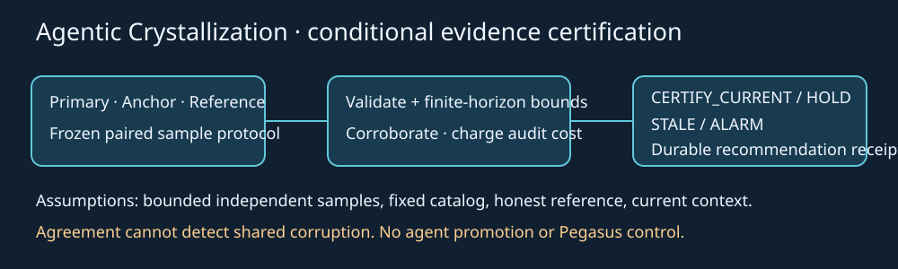

# Agentic Crystallization
## v2.4 — Independent Verification, Adaptive Trust, and Mathematical Cooling



> **A crystal that cannot question its measurements will eventually preserve errors.**

**Status:** Complete **synthetic research release**. Not a claim of physical crystallization, universal feedback trust, self-sustaining AGI, or validated Pegasus performance. No live deployment was performed.

[**Start here**](#the-result-in-30-seconds) · [**Whitepaper**](docs/WHITE_PAPER.md) · [**PDF**](Agentic_Crystallization_2.4.pdf) · [**Proofs**](docs/MATHEMATICS_2.4.md) · [**Algorithm**](docs/ALGORITHM_CARD_2.4.md) · [**Experiments**](docs/EXPERIMENTS_2.4.md) · [**Claims**](docs/CLAIM_LEDGER_2.4.md) · [**Agent context**](docs/FOR_AGENTS.md) · [**Continuity**](docs/CONTINUITY_AUDIT_2.4.md) · [**Changelog**](CHANGELOG.md)

## The result in 30 seconds

v2.3 showed that two feedback channels can agree while jointly wrong. v2.4 adds a separately sampled, paid audit reference, applies simultaneous finite-horizon current-epoch bounds, quarantines disagreements and records audit costs. It then tunes the audit schedule exclusively on development seeds and tests the frozen decision rule on fresh worlds.

**Main positive result:** In the shared-corruption condition with an honest independent reference, v2.4 recorded **zero incorrect fresh certifications** against **402** from the v2.3 two-channel guard on the 80-world holdout, plus **479 alarms**.

**Main negative results:** All-three-channel corruption still produced **320 incorrect fresh certifications and no alarms**; the third channel lowered utility in most honest tasks; and a tuned adaptive audit schedule exactly **matched the simpler periodic controller** on holdout. Our result is a conditional safeguard, not universally better adaptive trust.

## Visual results


## Independent held-out results

**1,040 worlds × 24 epochs × 8 policies = 199,680 policy-epoch records.** Replication adds **520 worlds and 99,840 records**. All gains and costs are synthetic utility units per epoch. Higher is better.

| Regime | v2.4 triad | v2.3 guard | Primary only | Reference only | Triad false fresh | Triad alarms |
| --- | --- | --- | --- | --- | --- | --- |
| Stationary | +23.37 | +25.99 | +27.62 | +24.93 | 0 | 0 |
| Abrupt change | +23.29 | +25.82 | +27.56 | +24.93 | 0 | 0 |
| Gradual drift | +9.66 | +14.69 | +17.41 | +16.01 | 0 | 0 |
| Recurring patterns | +13.84 | +24.09 | +18.22 | +15.59 | 0 | 0 |
| Corrupted primary | +3.16 | +4.49 | -9.72 | +24.93 | 0 | 479 |
| Corrupted anchor | +3.19 | +4.49 | +27.62 | +24.93 | 0 | 480 |
| Shared primary + anchor error | +3.16 | -11.31 | -9.66 | +24.93 | 0 | 479 |
| Compromised reference | +3.16 | +25.82 | +27.56 | -12.41 | 0 | 479 |
| All three compromised | -13.96 | -11.31 | -9.66 | -12.41 | 320 | 0 |
| Reference missing | +7.76 | +25.82 | +27.56 | +8.31 | 0 | 0 |
| Anchor missing | +4.31 | +7.49 | +27.56 | +24.93 | 0 | 0 |
| Misleading warning | +23.39 | +20.04 | +27.62 | +24.93 | 0 | 0 |
| No learnable advantage | -6.14 | -1.89 | -0.38 | -4.10 | 0 | 0 |

**The correct product choice is conditional:** prefer the lower-cost v2.3 guard when its two channels have externally justified reliability; use additional independent auditing only when its expected reduction in undetected harm justifies verification costs. Never claim sensors establish their own honesty by agreement.

## What the mathematics certifies

Under independent, bounded and honest reference measurements, a current-epoch action is supported only when the reference's lower confidence limit exceeds both the baseline and the other action's upper limit. With three channels, the controller requires corroboration and quarantines gross disagreements. A finite-horizon simultaneous Hoeffding union bound controls false **fresh** certification events conditional on the reference's honesty. The theorem does *not* cover stale retention or future environmental changes.

The [indistinguishability result](docs/MATHEMATICS_2.4.md#6-indistinguishability-more-agreeing-sensors-cannot-prove-truth) establishes that if two worlds have identical observable histories and opposite true gains, no observational controller can reliably choose the right non-baseline action in both. This is the precise mathematical obstacle the all-corrupt regime demonstrates.

## Run the package

Python 3.10+ and runtime dependencies in `requirements.txt`; Windows PowerShell 5.1+ has one root entry point. Extract the ZIP, open a terminal in the extracted project directory and run:

```powershell
python -m pip install -r requirements.txt
.\run.ps1 -Action test
.\run.ps1 -Action verify
.\run.ps1 -Action demo
# Separate, non-overwriting simulation with new seeds:
.\run.ps1 -Action simulate -StartSeed 90000 -Worlds 3
```

Cross-platform:

```bash
export PYTHONPATH=src OPENBLAS_NUM_THREADS=1
python -m unittest discover -s tests -q
python scripts/verify_stage_p.py . --cohort stage_p_holdout
python scripts/verify_stage_p.py . --cohort stage_p_replication
python scripts/research_verify.py
# New experiment; never overwrite the frozen cohorts:
python -m agentic_crystallization.stage_p --out experiments/my_new_trial --start-seed 90000 --count 3 --max-age 4 --no-cue
```

## Repository navigation

```text
agentic-crystallization/
├── README.md                       Human guide and result summary
├── run.ps1                         Single Windows entry point
├── Agentic_Crystallization_2.4.pdf   Complete research whitepaper
├── docs/                           Proofs, algorithm, claim ledger, historical docs
├── src/agentic_crystallization/     All preceding research + new v2.4 modules
│   ├── adaptive_trust.py            Paid audit, trust and quarantine policy
│   └── stage_p.py                   Frozen Stage P experiment driver
├── tests/                          Full regression suite + v2.4 counterexamples
├── experiments/
│   ├── stage_p_tuning/             Development-only hyperparameter search
│   ├── stage_p_frozen_source.json  Source/tuning freeze before holdout
│   ├── stage_p_holdout/            Untouched final 1,040-world cohort
│   ├── stage_p_replication/        Independent 520-world replication cohort
│   └── stage_p_analysis.json       Paired world-bootstrap descriptive intervals
├── scripts/verify_stage_p.py       Read-only receipt and source verifier
├── assets/                         Banner + genuine measured charts
├── archive/                        Sealed complete v2.3 ZIP baseline
└── docs/provenance/               Original inventory and recovery audit
```

## Research claim boundary

- No autonomous Pegasus operation, verified real-world self-improvement, novel physical equation or critical self-organization threshold is claimed.
- Old knowledge may be **remembered** without being **currently certified**. A certificate is current-epoch evidence, not an eternal statement.
- The Beta-smoothed observed mismatch rate is a diagnostic only; adaptive selection and shared errors prevent inferring calibration by default.
- No changes to historical evaluator, sealed prior ZIP, or prior source code were made, other than adding new v2.4 modules and docs.
- Every negative result is preserved and required by regression tests.

**Licensing:** No license has been assigned; obtain one before redistributing publicly.


## Independent Python package preview

Install with `python -m pip install .` or run `./run.ps1 -Action setup`.
The research algorithm remains v2.4; packaging metadata is 2.4.0rc1.
Historical `agentic_crystallization.__version__` is preserved; use
`importlib.metadata.version("agentic-crystallization")` for the installed distribution version.
See [external evidence API](docs/API.md), [architecture](docs/ARCHITECTURE.md),
[audit](docs/SOURCE_AUDIT.md), [reproducibility](docs/REPRODUCIBILITY.md),
and [Pegasus plan](docs/PEGASUS_INTEGRATION.md).

```python
from agentic_crystallization.evidence_api import evaluate
from agentic_crystallization.example_evidence import example

receipt = evaluate(example(), now=10, current_epoch=0, current_context="demo-context")
print(receipt.status, receipt.reason)
```

The example is synthetic, and its trust declarations are illustrative.
External evidence support is a preview, constrained to two candidates and three channels.
No automatic sampling, host integration, deployment, or improvement claim is included.
Next steps: independent contract review, externally justified measurement provenance,
then a separately authorized read-only Pegasus adapter trial.

## Publication status

Private research preview. No public license selected and no public publication authorized.
Public release remains HOLD pending license approval, review of release evidence and explicit approval.
Use [CITATION.cff](CITATION.cff) and cite the exact commit.
