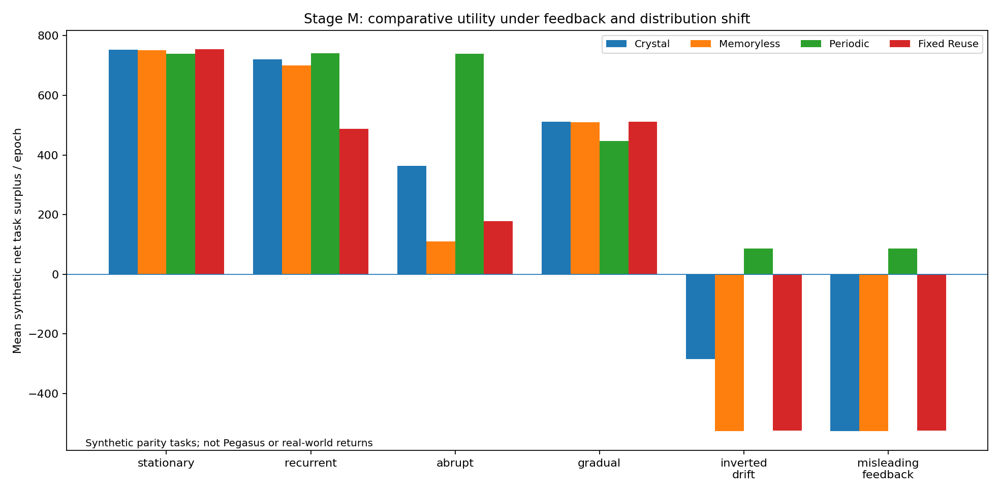
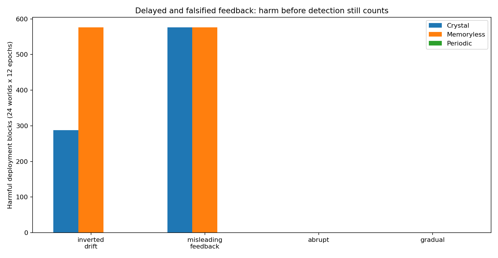
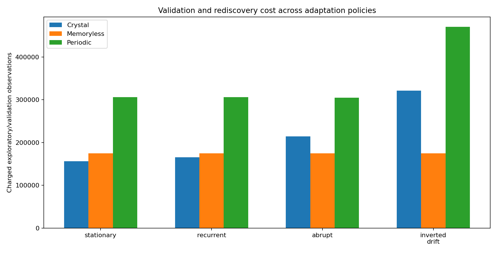

# Stage M — Experimental Protocol, Results and Falsification Report

**Release:** Agentic Crystallization v2.1.0.  
**Scope:** finite seeded simulation; XOR procedures; no Pegasus benchmark.  
**Frozen design:** [PREREGISTRATION_STAGE_M.json](PREREGISTRATION_STAGE_M.json).  
**Full raw holdout:** [runs.csv](../experiments/stage_m_holdout/runs.csv).  
**Source hashes and protocol:** [protocol.json](../experiments/stage_m_holdout/protocol.json).  
**Independent replication:** [replication CSV](../experiments/stage_m_replication/runs.csv).  
**Paired descriptive bootstrap:** [analysis JSON](../experiments/stage_m_holdout_analysis.json).

## 1. Question and comparisons

Can a finite, auditable agent system revalidate previously useful procedure combinations and withdraw them when fresh paired feedback indicates a loss of value? We compare the *cost of doing so* and the *damage before delayed detection* with simpler and more aggressively validated policies. The goal is not to find a controller that wins by definition.

The experimental unit is a synthetic world seed: one world fixes its latent permitted/parity concepts, then all six policies receive the same independently seeded task packets. There are 12 epochs per world. Each epoch has three consecutive blocks, with a new latent law permitted at a block boundary. Each policy sees its own past receipts but not hidden concepts or analytic true gains.

**Final untouched holdout:** 24 world seeds, starting at 51000, eight regimes, six policies, 12 epochs: **13,824 policy-epoch evaluations**. Each epoch includes three deployment blocks; the held-out dataset contains 41,472 policy-block evaluations. Distinct independent replication seeds 81000–81007 produce another **4,608 policy-epoch evaluations**. A four-world exploratory cohort was used before source-code freezing, not included in claims about independent performance. The earlier pre-hardening exploratory output is marked as such and not presented as an auditable frozen-code run.

**Outcome boundaries:** All findings concern seeded mathematical tasks. The hidden analytic scoring formula is in the **evaluator only**. The crystal policy receives scout/discovery observations, fresh validation, and subsequent *reported* task labels, but no generator ground truth.

## 2. Eight regimes

| Regime | Construction and test purpose |
|---|---|
| `stationary` | Same planted three-way XOR relation throughout; monitor false-alarm control and efficiency |
| `recurrent` | Previously seen XOR relations recur across epochs; a subset of epochs changes within the episode |
| `abrupt` | The true XOR target changes immediately after the first deployment block; replacement can be learned only with subsequent evidence |
| `gradual` | The middle and late blocks gradually mix a second XOR task at probability 0.30 and 0.50; weak-to-moderate degradation detection |
| `inverted_drift` | Outcomes invert after initial certification, making the formerly useful procedure harmful; tests monitoring lag and retirement |
| `unlearnable` | Some target epochs use four-way XOR, outside the permitted one-to-three-feature family; tests abstention |
| `missing_feedback` | Middle-block task labels unavailable to the monitor; must HOLD the final block, not interpret absence as success |
| `misleading_feedback` | Actual outcomes invert but the monitoring channel falsely reports the original labels; **violated data-integrity premise** |

The last regime is a deliberately impossible-to-detect case under the given observations; it is not a calibration failure that can be repaired merely by increasing the sample size.

## 3. Six competing policies

| Policy | Behavior / information budget |
|---|---|
| **`crystal`** | Retain bounded procedure memory; scout remembered candidates; fresh epoch-start certification; observe delayed middle-block feedback; if significant loss then suspend old candidate and scout/search/certify a replacement before the final block; HOLD if feedback missing |
| `monitor_hold` | Same memory and drift test, but after an alarm uses baseline instead of attempting recovery in the last block |
| `memoryless` | Full candidate discovery and independent validation at each new epoch; retains no procedure memory and does not react within the epoch |
| **`periodic`** | Fresh discovery and independent validation **before each of the three blocks**; more expensive but does not rely on delayed alarms to handle intra-epoch changes |
| `fixed_reuse` | Fixes the first successful candidate permanently as the only candidate; it still checks that candidate at each epoch start, but never switches to another and continues it within the epoch without intra-epoch revalidation |
| `baseline` | Constant-zero predictor; no adaptive procedure cost |

`fixed_reuse` is an intentionally constrained comparison, not a zero-validation strawman. `periodic` is a substantive safety comparator and often wins the abrupt-change settings.

## 4. Data volumes, uncertainty and resource accounting

- Binary feature width 8; permitted whitelist contains **92** nonbaseline XOR combinations (order one, two or three).
- Each fresh selection may use scout `24`, discovery `96`, and up to `512` independently sampled validation observations. Predetermined validation looks: `(64,128,256,512)`.
- Deployment block sizes are `(256,768,512)` tasks. The middle-block task feedback is received only **after** those 768 actions have executed; changing the source after block zero cannot be prevented retroactively.
- A successful initial certification uses the full first-block 512-row independent validation pool as the reference for later drift monitoring; the extra rows after an earlier successful checkpoint are charged.
- Promotion error budget 0.025 per lifelong controller run; drift-monitor error budget another 0.025; each indexed slot gets a telescoping lifetime allocation.
- A drift alarm compares the current and reference paired gains using an upper confidence bound on their difference. `CLEAR` means *no statistically significant loss detected*, not no change.
- Each controller starts with **150 synthetic credits**. Scout/discovery/validation sample price 0.025, prediction operation price 0.00002, retained entry maintenance 0.1, feedback-processing price 0.0005. External correct task answers replenish credits at 0.2 each. A maximum-cost reserve prevents overdrafts.
- Mean net surplus per epoch equals the observed number of additional correct predictions relative to constant-zero **minus charged sampling, prediction and maintenance costs**. Units are synthetic; they are neither dollars nor physical energy.
- All paired confidence intervals reported below are **descriptive 95% bootstrap intervals over world seeds** (3,000 resamples). They are not confirmatory frequentist familywise inference for numerous policy comparisons; the mathematically specified error budget applies to individual promotion and monitoring certificates under their assumptions, not to the aggregate bootstrap.

## 5. Final holdout results



### Mean synthetic net surplus per epoch

| Environment | Crystal | Memoryless | Periodic | Fixed reuse |
|---|---:|---:|---:|---:|
| Stationary | **753.19** | 751.87 | 740.15 | **754.23** |
| Recurrent | **721.08** | 699.82 | **741.23** | 488.62 |
| Abrupt change | **364.12** | 110.63 | **740.07** | 178.38 |
| Gradual shift | 511.15 | 509.83 | 446.63 | **512.19** |
| Inverted outcomes | **−283.93** | −526.49 | **+86.72** | −524.13 |
| Unlearnable four-way tasks | 208.47 | **211.53** | 188.18 | **213.01** |
| Missing feedback | 111.61 | 110.39 | **739.41** | 112.75 |
| Misleading feedback | **−525.17** | −526.49 | **+86.72** | −524.13 |

**No universal winner.** The crystal improves on memoryless adaptation for the planted recurrence and sudden-change scenarios, but periodic pre-block recertification is significantly stronger for abrupt changes and harmful inversions. On stationary and gradual tasks the fixed candidate is marginally cheaper, so extra monitoring is not automatically valuable.

### Mechanism and negative-control receipts

| Prespecified observation | Final holdout (24 worlds × 12 epochs) | Interpretation |
|---|---:|---|
| Retained memory procedures freshly recertified, recurrent regime | **216** | Savings in new candidate-search computation without trusting old authority |
| Confirmed deterioration alarms, abrupt regime | **288** | 288/288 epochs experience a detectable abrupt decline |
| Confirmed deterioration alarms, inverted regime | **288** | Actual harmful change is detected after middle-block exposure |
| Harmful deployment blocks despite alarm, inverted regime | **288** | One feedback-block lag is real; the monitor cannot undo past harm |
| Missed deterioration events, gradual regime | **288** | No alarms despite substantial graded changes; the conservative test lacks power |
| Harmful deployment blocks, misleading-feedback regime | **576** | A deceptive feedback channel defeats the monitor; 0 alarms |
| False fresh promotions in the held-out evaluator | **0 observed** | Consistent with the within-block certificate; not proof assumptions always hold |
| Cost ledger violations | **0 observed** | Preflight reserve and transaction checks are enforced |



### Paired policy differences

The predeclared primary endpoint is **mean net surplus per epoch**, compared world-by-world against alternative policies. The crystal exceeded memoryless adaptation on recurrent tasks by **+21.265** units per epoch (descriptive paired-world bootstrap 95% interval **[+20.807, +21.720]**). Under abrupt change it exceeded memoryless adaptation by roughly **+253.5** units per epoch, but fell below periodic pre-block recertification by **−375.951** units (descriptive interval **[−377.560, −374.315]**). See the [machine-readable paired analysis](../experiments/stage_m_holdout_analysis.json) for all regimes and comparator policies.

These values reflect very specific synthetic task sizes, reward scales, cost prices, and a fixed XOR search family. They are not estimates of Pegasus latency, model accuracy, production cost savings, or long-run economic returns.



## 6. Separate replication cohort

Eight additional independent world seeds (81000–81007) confirm the direction of the prominent findings without any code refitting:

| Environment | Crystal | Memoryless | Periodic |
|---|---:|---:|---:|
| Stationary | 753.57 | 752.25 | 740.29 |
| Recurrent | 719.65 | 697.90 | 739.48 |
| Abrupt | 365.37 | 113.39 | 741.37 |
| Gradual | 513.29 | 511.96 | 448.39 |
| Inverted | −283.25 | −526.38 | +87.50 |
| Misleading feedback | −525.06 | −526.38 | +87.50 |

The replication manifest and its complete raw rows are preserved separately. This agreement is unsurprising to some extent because the same planted generator and protocol produced both cohorts; it is **not cross-domain generalization**.

## 7. Failures and their mathematical meaning

**Delayed feedback.** In the inversion regime the controller cannot act on labels it has not received. It correctly raises alarms but still executes 288 harmful middle blocks. Periodic advance validation avoids the delayed exposure because it acquires fresh block-specific information before each block, at higher validation/search cost.

**Gradual concept mixing.** The monitor correctly refuses to label weak evidence as a certain change; its threshold has limited power at the selected sample sizes. All 288 truly degraded cases in the gradual regime go undetected. `CLEAR` is therefore a weak safety signal and cannot be used as an unconditional license for future deployment.

**Misleading measurement channel.** Reported outcomes are deliberately generated from an unchanged relation while the actual task labels are inverted. Statistical confidence computed from that channel is confidence in the *wrong observational law*. The crystal issues zero alarms and incurs 576 harmful deployment blocks; an independent trustworthy channel or pre-block validation is necessary to detect this class of failure.

**Unlearnable family.** Four-way XOR relationships are outside the permitted three-way procedure class. The system cannot honestly discover and certify them and should not be allowed to enlarge its own authorization to bypass the negative control.

**No perpetual guarantee.** Task revenues are external, monitoring depends on observed labels, the process is simulated for a finite 12 epochs per world, and the retained structure is finite. These results show conditional self-regulation, not a computational object that can sustain itself indefinitely without inputs or assumptions.

## 8. Claims accepted and rejected

Supported within this synthetic protocol: independent fresh certification, selected memory reactivation, timestamped retirement/renewal transitions, some abrupt deterioration alarms, bounded operation, replayable receipts, and comparative lower search work in recurrence.

**Not established:** reliable detection of gradual drift; resilience to missing or falsified feedback; unconditional correct future procedures; a critical crystallization phase transition; novel thermodynamic laws; general-purpose recursive self-improvement; or measured Pegasus benefit.

## 9. Reproduce and verify

On Windows PowerShell, from the extracted package root:

```powershell
$env:PYTHONPATH='src'
python -m unittest discover -s tests -v
python scripts/verify_stage_m.py experiments/stage_m_holdout --repo .
python scripts/verify_stage_m.py experiments/stage_m_replication --repo .
python -m agentic_crystallization.stage_m --out ../AC_local_replay --start-seed 51000 --count 2
```

The independent replay command produces only two worlds, not all 24. To compare with the original raw file, filter original `runs.csv` to seeds 51000 and 51001, sort consistently by the deterministic protocol order, and compare. The analysis script `scripts/analyze_stage_m.py` rebuilds paired confidence intervals from raw results; the plot script rebuilds figures from the frozen JSON summary.

Verification checks raw CSV enumeration, summary recomputation, stored source hashes, row-level invariants, and file SHA-256 receipts. Hashes detect accidents or unexpected edits **but are not digital signatures**.

## 10. Next falsifiable step

The strongest next challenge is **feedback-source validity**. A calibrated monitor relying on false labels is mathematically incapable of reliably identifying hidden deterioration. Future work should compare trustworthy sentinel probes, selective pre-block validation, conservative baseline fallback, and verification-cost budgets across changing feedback reliability and sparse outcome availability—without giving the controller oracle information about whether its labels are genuine.
