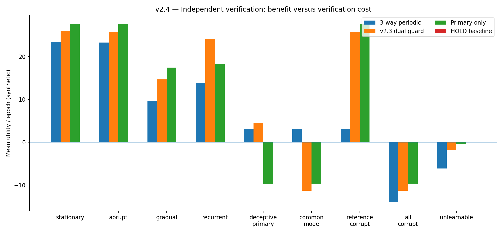
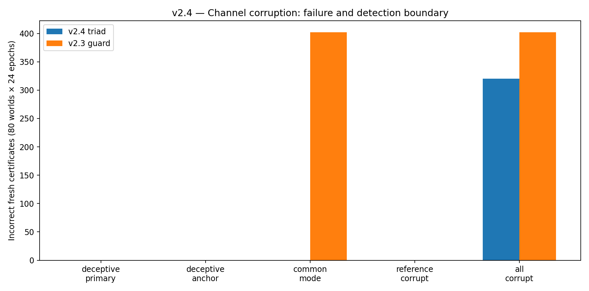

# Agentic Crystallization v2.4 — Independent Audit, Adaptive Trust, and Cooling to a Minimal Rule

**Research whitepaper · Synthetic evaluations · Historical continuity v1.0–v2.3 preserved**

## Abstract

Agentic Crystallization investigates whether an adaptive system can discover, validate and retain useful interacting procedures under cost and uncertainty constraints. Versions 2.0–2.3 implemented a bounded synthetic adaptation loop, renewed certificates under environmental change, tested risk-based verification and showed that two feedback streams can agree while jointly misleading an agent. Version **2.4** adds an independently sampled third audit reference, optional risk-triggered rechecks, counters for gross channel disagreement, automatic quarantine on contradiction, and an explicit reference-compromise falsification test.

The principal finding is **conditional**: with an honest reference, the triple-check controller records zero incorrect *fresh* certifications when primary and anchor are jointly corrupted, compared with 402 for the v2.3 two-channel guard (80-world holdout). Its mean synthetic utility in that regime is +3.16 per epoch, compared with -11.31 for the guard. Conversely, in honest stationary, gradual, or recurring environments the extra audits reduce utility. If all three channels share a corruption, v2.4 still issues 320 incorrect fresh certifications. There is no universal trust inference from mere agreement.

The development search selected a four-epoch audit interval with cue-triggered checks disabled. **Its held-out actions exactly matched a simpler four-epoch periodic controller**, a negative result against unnecessary complexity. The closed loop remains a synthetic research prototype, not a proven self-sustaining computational crystal.

## 1. Scientific objective and continuity

The research began with an analogy between physical crystallization and the selection of reusable configurations of procedures. That analogy does not identify a physical law. Historical mechanisms include Möbius higher-order interactions (v1.0–1.1), conditional transfer and negative transfer (v1.2–1.3), Bayesian information acquisition (v1.4–1.6), robust decision certificates (v1.7–1.8), sequential evidence efficiency (v1.9), persistent candidate-selection loops (v2.0), environmental renewal (v2.1), risk-adaptive verification (v2.2), and dual-channel integrity limits (v2.3).

The new falsifiable question is narrower: **How much additional independent feedback is needed to protect against channel corruption, and is its value worth the cost?** The full historical source, datasets and reports remain in this archive. Previous v2.3 documentation is separately archived.

## 2. Mathematical object and conditional theorem

At epoch $t$, a bounded synthetic gain $g_t(a)$ describes either procedure A or B relative to a zero-gain fallback. The policy does not know $g_t$. Each measurement channel supplies a bounded sample average; the reference's random seed is independent of the original two streams when it is honest.

With $T=24$ epochs, $K=2$ actions, $C=3$ channels and familywise error budget $\alpha=.05$, define:

$$r_c(n)=\sqrt{\frac{2\log(2TKC/\alpha)}{n}}.$$

If each reference observation is independent, bounded and has expectation equal to the *current* action gain, then the reference-only lower/upper interval simultaneously covers those gains across the prespecified horizon with probability at least $1-\alpha$. A fresh certificate is issued only if the reference's lower bound exceeds zero and the competing action's upper bound, and the other two channels separately support the same action without significant discrepancy.

**This guarantee is conditional on honest reference measurements.** It is not an empirical proof of honesty. Stale deployments in intervening epochs are not covered. Details and proofs are in [Mathematics v2.4](MATHEMATICS_2.4.md).

## 3. The research algorithm

The v2.4 controller implements **pre-committed audits**: before the independent reference result can enter the policy, a scheduling function decides whether to pay for it. Then the controller either certifies a current procedure, retains a previously supported choice with an explicit stale label, or selects the safe baseline. Significant discrepancies quarantine the evidence and trigger bounded follow-up checks rather than a majority vote.

The measured disagreement indicator is $D=1$ if any corresponding sample means differ by more than their simultaneous error radii. A Beta(1,1)-smoothed mismatch frequency is retained as an **uncalibrated descriptive statistic**, not a probability of truth. No version of the controller is permitted to infer ground truth solely from multiple channels agreeing.

Development compared eight predeclared parameter configurations: maximum verification ages of 3, 4, 6 and 8 epochs, each with cues enabled or disabled. The chosen setting was **four epochs without cue-triggered audits**. This matches simple scheduled verification on the independent holdout; therefore the complex scheduler is not justified as a production default.

## 4. Experimental design

- **Simulator:** 24 epochs per world, two whitelisted candidate procedures and zero-gain baseline; true gains defined by a planted task generator.
- **Observations:** 384 primary and 384 anchor samples per action, 1,024 independent reference samples per action when purchased; each channel can be separately corrupted.
- **Costs:** primary .002, anchor .006, independent reference .006 synthetic units per observation; task reward scaled to 80 task instances per epoch.
- **Policies (8):** tuned triad adaptive, simple periodic triad, every-epoch triad, reference-only periodic, reference-only every-epoch, v2.3 dual guard, primary-only periodic, and zero-gain baseline.
- **Development:** 18 seeds (4200–4217), nine comparison regimes; hyperparameters frozen before holdout.
- **Holdout:** 80 fresh seeds (9000–9079), 13 regimes, 1,040 worlds, 199,680 policy-epoch records.
- **Independent replication:** 40 seeds (11000–11039), 520 worlds, 99,840 records.
- **Controls:** honest stationary and shifting tasks; one-channel corruption; two-channel shared corruption; compromised reference; all-channel shared corruption; missing reference or anchor; misleading warning; unlearnable tasks.
- **Integrity:** code-source hashes frozen before holdout, deterministic recorded seeds, SHA256 manifests, read-only receipt verifier and clean independent replay.

## 5. Full held-out outcome table

**Mean synthetic net utility per epoch, higher is better.** The last two columns count v2.4 triad incorrect fresh certificates and discrepancy alarms across all 80 worlds, 24 epochs each. They do not count stale harmful deployments.

| Regime | v2.4 triad | v2.3 guard | Primary only | Reference only | Triad false fresh | Triad alarms |
| --- | --- | --- | --- | --- | --- | --- |
| Stationary | +23.37 | +25.99 | +27.62 | +24.93 | 0 | 0 |
| Abrupt change | +23.29 | +25.82 | +27.56 | +24.93 | 0 | 0 |
| Gradual drift | +9.66 | +14.69 | +17.41 | +16.01 | 0 | 0 |
| Recurring patterns | +13.84 | +24.09 | +18.22 | +15.59 | 0 | 0 |
| Corrupted primary | +3.16 | +4.49 | -9.72 | +24.93 | 0 | 479 |
| Corrupted anchor | +3.19 | +4.49 | +27.62 | +24.93 | 0 | 480 |
| Shared primary + anchor error | +3.16 | -11.31 | -9.66 | +24.93 | 0 | 479 |
| Compromised reference | +3.16 | +25.82 | +27.56 | -12.41 | 0 | 479 |
| All three compromised | -13.96 | -11.31 | -9.66 | -12.41 | 320 | 0 |
| Reference missing | +7.76 | +25.82 | +27.56 | +8.31 | 0 | 0 |
| Anchor missing | +4.31 | +7.49 | +27.56 | +24.93 | 0 | 0 |
| Misleading warning | +23.39 | +20.04 | +27.62 | +24.93 | 0 | 0 |
| No learnable advantage | -6.14 | -1.89 | -0.38 | -4.10 | 0 | 0 |

### Focused comparisons

- **Honest stationary:** triad +23.37, guard +25.99, primary-only +27.62. Extra verification costs utility.
- **Gradual drift:** triad +9.66, guard +14.69. The triad's extra checks do not solve changing latent task structure.
- **Recurring patterns:** triad +13.84, guard +24.09. Independent reference can over-verify a cheap memory reuse process.
- **Common-mode corruption of the original pair:** triad +3.16 versus guard -11.31; triad 0 incorrect fresh certifications and 479 alarms versus guard 402 incorrect fresh certifications and no alarms.
- **Reference compromised:** triad +3.16 versus guard +25.82. Disagreement allows safe quarantine but not attribution of which channel is wrong.
- **All channels compromised:** triad -13.96, 320 incorrect fresh certifications and 0 alarms. More agreeing validators cannot identify systematically wrong evidence.
- **Unlearnable environment:** triad -6.14, baseline 0; spending audit resources without a learnable advantage remains a failure.

These are effects produced by this exact synthetic simulator, not predictions of Pegasus behavior. Independent replication reproduced the qualitative results, including 0 triad fresh false certifications under two-channel corruption with an honest reference and 160 incorrect fresh certifications when all three channels were corrupted.

## 6. Statistical and epistemic limits

The Hoeffding theorem bounds false **fresh** certifications across fixed epochs under honest independent reference observations. It cannot certify audit provenance, prevent changes after a measured epoch, guarantee outcomes of stale deployments, or detect correlated corruption of all observables. Adding sensors only creates an external cross-check if those sensors really provide independently grounded evidence; otherwise, the indistinguishability impossibility result applies.

Training-seed performance was used to choose the audit policy. Holdout bootstrap contrasts are descriptive and not claims of preregistered confirmatory significance. Neither tuning nor the observed success justifies silently increasing the policy's real-world authority.

## 7. Algorithmic consolidation result

**A stable research design is allowed to get simpler.** v2.4 shows that a richer adaptive audit schedule can collapse to a fixed schedule on independent data. Retaining the sophisticated heuristic without independent evidence of benefit would violate the research objective of evidence-governed optimization.

We therefore **keep three-way periodic verification as the experimental integrity safeguard**, keep the v2.3 two-channel guard as a lower-cost alternative under justified assumptions, and preserve the full v2.4 adaptive implementation solely for ablation and future hypotheses.

## 8. Next falsifiable research question

The unsolved problem is *not* to manufacture higher confidence by accumulating correlated signals. It is to establish a trustworthy audit provenance and sample an independent consequence of deployed decisions under real tasks. A future experiment should test independently adjudicated outcome labels, intervention cost, audit compromise, slow adversarial corruption below detection thresholds, and budgeted abstention. Without genuinely identifying observations, the task is provably impossible for some pairs of environments.

**No claim is made that digital computation has undergone a physical crystallization phase transition, that v2.4 produces indefinite self-improvement, or that Pegasus/Hermes was executed or improved.**

## 9. Reproducibility and evidence links

[Run instructions](../README.md) · [Source](../src/agentic_crystallization/adaptive_trust.py) · [Stage P driver](../src/agentic_crystallization/stage_p.py) · [Raw holdout](../experiments/stage_p_holdout/runs.csv) · [Protocol](../experiments/stage_p_holdout/protocol.json) · [Development tuning](../experiments/stage_p_tuning/tuning.json) · [Frozen code](../experiments/stage_p_frozen_source.json) · [Replication](../experiments/stage_p_replication/runs.csv) · [Claim ledger](CLAIM_LEDGER_2.4.md) · [Historical prior](archive/WHITE_PAPER_2.3.md).
