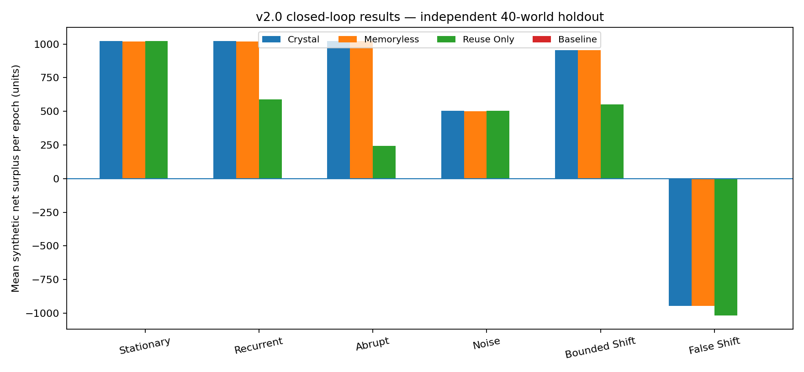
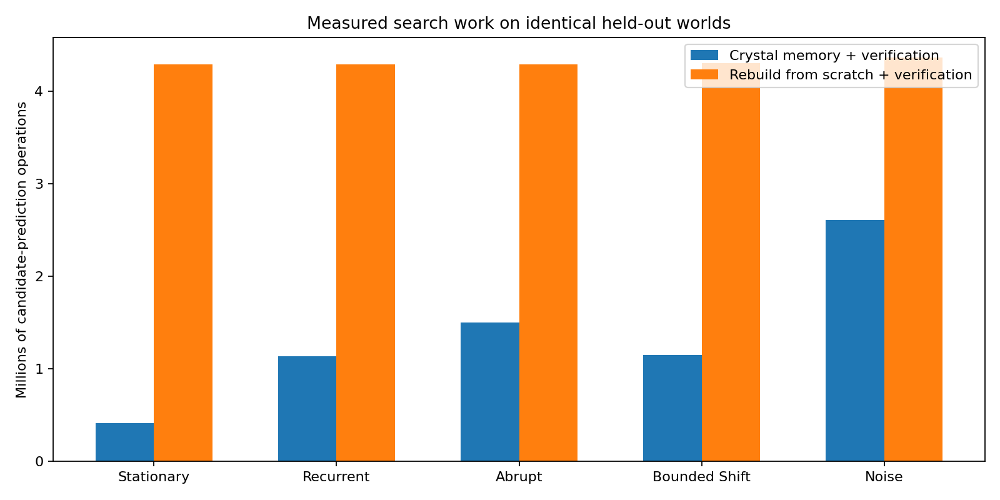
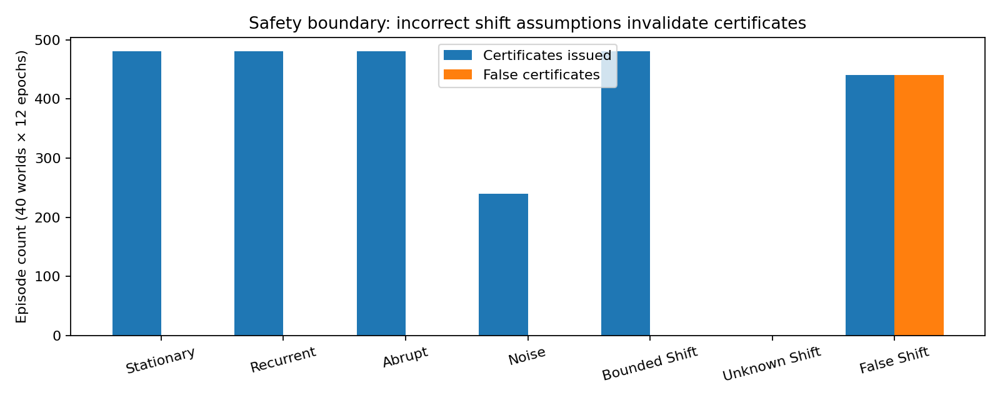

# Agentic Crystallization v2.0
## A Governed Closed-Loop Prototype for Conditional Procedure Discovery, Certification, and Retention

**Version:** 2.0.0  
**Research status:** Executable synthetic prototype; conditional mathematical guarantees; no literal phase transition or general self-improvement established.  
**Continuity:** All v1.0–v1.9 sources, experiments, mathematical papers, and audited v1.9 ZIP are preserved.  

[Precise proofs](MATHEMATICS.md) · [Algorithm](ALGORITHM_CARD.md) · [Complete protocol](PREREGISTRATION_STAGE_L.json) · [Raw results](../experiments/stage_l_holdout/runs.csv) · [Original v1.9 paper](archive/WHITE_PAPER_1.9.md)

### Abstract

Agentic Crystallization investigates whether interacting, validated computational procedures can form persistent, useful structures that lower the cost of adapting to future tasks. Versions 1.0–1.9 isolated higher-order utility interactions, environmental negative transfer, Bayesian relevance estimates, bounded-error decision certificates, and sequential evidence stopping. However, these studies did not produce an autonomous procedure-discovery/retention lifecycle. Version 2.0 implements a finite, controlled loop that proposes XOR compositions without access to the hidden target, evaluates a single preselected candidate on independent observations, certifies positive expected benefit using a lifetime error-spending rule, durably retains eligible compositions, prunes or revalidates memory after drift, and charges task-feedback and computational costs against a nonnegative resource account. A separate synthetic test harness provides recurring, abruptly changing, four-way-unlearnable, appropriately bounded-shift, unknown-shift, and deliberately falsified-shift worlds. The new artifact is a reproducible **closed-loop prototype**, not evidence that arbitrary digital information self-organizes by itself or that the system can run indefinitely without external energy and rewards.

## 1. Why v2.0 and what would count as success?

A system cannot be considered self-sustaining merely because it has a memory database, a reward estimator, and an agent loop. Those components can accumulate stale, incorrect procedures. We require an explicit feedback mechanism that autonomously performs all five steps, without a human directing each individual episode:

1. Propose candidates from a permitted procedure algebra.
2. Evaluate a proposal using observed task outcomes, not privileged generator truth.
3. Certify or HOLD on statistically independent evidence with externally justified shift assumptions.
4. Retain, revalidate, reactivate, and prune procedural structures under bounded capacity.
5. Account for computation, maintain a durable replayable state, and refuse unaffordable or unjustified work.

Even all five properties demonstrate only **bounded operational closure**. They do not prove unbounded survival or emergent consciousness. The experiment tests whether the components work together in finite, observable trajectories.

## 2. Mathematical object and interaction substrate

Define a bounded computational crystal $\mathcal C=(\mathcal P,\mathcal G,M,\mathsf Cert,B,L)$, where $\mathcal P$ is a whitelisted procedure family, $\mathcal G$ an evidence-conditioned candidate generator, $M$ bounded procedural memory, $\mathsf Cert$ a conditional sequential decision certificate, $B$ task-feedback credits, and $L$ a hash-linked receipt ledger. The state evolves as $s_{t+1}=T(s_t,o_t)$ as the task stream supplies fresh observations $o_t$.

Our control environment plants a three-way parity relation in eight independent binary features. No one-feature or two-feature subset predicts the target better than chance. A candidate XOR of the correct three features achieves perfect accuracy on the source law. Defining $J(S)$ as the Bayes-optimal prediction accuracy using only a feature subset $S$, the triple Möbius interaction is exactly $+1/2$, with zero empty-baseline pairwise terms. This is standard finite-difference mathematics on a synthetic constructed task. It is **not** a discovery of a natural crystallization force or critical exponent.

The permitted runtime search space includes 92 XOR expressions of order one, two, or three, plus a constant baseline. A four-way parity task is a structural **negative control**: it has no exact solution in this fixed candidate family. Crucially, the runtime does not receive the true parity indices. It must rank candidates using exploratory labeled examples.

## 3. Fresh certification and lifetime risk budget

Fix a candidate $\pi_e$ **before** seeing its independent validation stream. Define paired gain over baseline $D_e=1\{\pi_e(X)=Y\}-1\{\pi_0(X)=Y\}\in[-1,1]$. Let a trusted environment contract supply a direct bound on the change of its mean from validation to deployment, $|\mu_{P,e}-\mu_{Q,e}|\le\Delta_e$, otherwise return HOLD.

Allocate lifetime error allowance $\alpha=0.05$ across episodes as $\alpha_e=\alpha/[e(e+1)]$, and across four predeclared validation checkpoints $n\in\{64,128,256,512\}$. A lower confidence bound is

$$
\boxed{L_{e,j}=\widehat\mu_{e,j}-\sqrt{\frac{2\log(4/\alpha_e)}{n_j}}-\Delta_e.}
$$

Certify **positive gain relative to baseline** only if $L_{e,j}>\varepsilon$ with $\varepsilon=0.025$. Under fresh conditional IID within each episode, honest bounded gains, independent proposal/validation, a correct shift allowance, and a never-reset epoch/error ledger,

$$
\boxed{\Pr(\exists\text{ an incorrectly promoted episode over the lifetime})\le\alpha.}
$$

The proof is a one-sided Hoeffding bound unioned across checkpoints and the telescoping sequence of episode budgets. It is a conditional standard statistical guarantee; it does not claim globally optimal procedure selection. Detailed proof and all conditions: [MATHEMATICS.md](MATHEMATICS.md).

### Independent structure versus adaptive accumulation

A stored procedure is never considered certified in a new epoch. It is only nominated via a fresh contextual scout sample, then must pass the fresh certificate. A new task pattern triggers exhaustive search of the bounded procedure family. A recurring pattern can reactivate a previously stored candidate and avoid the full discovery search. Entries that cease receiving successful certificates expire or are evicted; at all times the memory size is at most four.

This gives a reproducible, operational meaning to *selective crystallization*: validated structural combinations are retained only when there is fresh evidence that they help in the present context. It does not assume permanent validity from past success.

## 4. Credits, retention, and the scope of “self-sustaining”

The state carries an evaluation credit balance $B_e$, with expenditure $C_e$ and nonnegative task-delivery revenue $R_e$. Its update is $B_{e+1}=B_e-C_e+R_e$, with a guard that enforces $0\le C_e\le B_e$. Therefore $B_e\ge0$ by induction from $B_0\ge0$. This is a **no-overdraft invariant**, not a free-energy theorem or a proof of indefinitely positive gains.

The benchmark separately measures *task utility improvement over the baseline minus evaluation, computation and memory expenses*. Those resource and utility units are synthetic. External tasks replenish the budget: the loop is **not closed with respect to matter, energy, or external information**. If there are no tasks, rewards, power, or justified environmental assumptions, the system cannot claim self-sustaining operation.

### Receipts and recovery

Each completed episode emits an immutable-intent JSONL receipt containing selected candidate, certificate status and interval, charged observations, procedure evaluation operations, outcome digest, resource movement, prior record hash, and pre-/post-state commitments. Restart reconstructs the state deterministically from the receipts. Truncation, reordered receipts, and changed bytes fail closed. The chain is **not** a trusted digital signature, is single-writer only, and does not authenticate untrusted originators; its replayability is still valuable for reproducibility and debugging.

## 5. Frozen experimental contract

Stage L compares four policies on the **same synthetic worlds**:

| Policy | Definition |
|---|---|
| `crystal` | Bounded generation + remembered candidate scout + fresh certification + bounded retention |
| `memoryless` | Full bounded candidate search in every epoch + the same fresh certification |
| `reuse_only` | Learn one initial candidate and never revise the candidate pool; fresh validation still required |
| `baseline` | Constant-zero procedure, no adaptive search |

Seven named regimes distinguish stable patterns, recurrence, abrupt concept changes, a four-way unlearnable pattern, known limited within-epoch shift, missing shift justification, and a deliberately false shift declaration. Each world contains **12 epochs**. The source/validation/live splits are disjoint pseudo-random streams derived from stable seed labels. The simulator sees the hidden task configuration; candidate-generation code receives only labeled examples and the declared shift allowance.

The complete final sample selection, locked code SHA-256 values, metrics, and negative controls are [preregistered here](PREREGISTRATION_STAGE_L.json). A separate development cohort was examined before freezing code. **Experiment outcomes and their limitations are reported below, including failed cases; do not optimize the code on holdout outcomes and then call the same cohort independent.**

## 6. Experimental results

_See [Stage L holdout summary](../experiments/stage_l_holdout/summary.json), [raw paired per-epoch results](../experiments/stage_l_holdout/runs.csv) and [figure](../assets/stage_l_results.png). The consolidated numeric table in the README is generated from these files._





The main performance contrast is whether memory-conditioned reactivation saves observations and procedure-prediction operations relative to rediscovering from scratch while maintaining the same opportunity to certify. A second essential contrast is whether a fixed initial procedure loses utility when target patterns change. No certification in the four-way negative control is a guard against overfitting. Missing shift justification must produce HOLD without fabricated confidence.



The false-shift case intentionally violates the theorem's premise. A successful negative control here is **observable erroneous certifications**. Reporting this failure is necessary to delimit every positive result.

## 7. What has *not* crystallized

We do **not** claim any observed computational phase transition, a self-organizing physical crystal, open-ended agent intelligence, an automatically valid drift bound, optimization over arbitrary programs, or real Pegasus productivity gains. The procedure family, source generator, proposal heuristics, checkpoint schedule and simulated credit exchange rates are chosen by the designers. Their usefulness for real agents would require new independent task and calibration data.

The proven ingredients are conditional error bounds and finite-memory/resource invariants. The observed ingredient is the autonomous finite loop in a controlled synthetic environment. Neither implies indefinite positive growth or self-sufficiency without external tasks.

## 8. Next research milestone and falsifiers

For v2.1, the relevant question is whether the same loop remains useful when *the proposal family expands, feedback arrives late, context drift must be estimated rather than provided, and evaluation costs vary*. A negative result is acceptable. No new mathematics should be promoted if it improves a single benchmark while violating safeguards or losing to simpler baselines.

A general self-sustaining computation claim would require a justified environmental-shift mechanism, replay-safe distributed receipts, accepted production data, positive amortized utility after **all** costs, long-horizon recovery, strong adaptive and causal baselines, and stable failure controls. v2.0 deliberately makes no such claim.

## Reproduce and inspect

```bash
PYTHONPATH=src OPENBLAS_NUM_THREADS=1 python -m unittest discover -s tests -v
PYTHONPATH=src python -m agentic_crystallization.stage_l --out experiments/local_run --start-seed 90000 --count 10 --demo-seed 2020
python scripts/verify_stage_l.py experiments/local_run --repo .
python scripts/verify_package.py .
```

Do not write to sealed experiment folders. [Human-facing README](../README.md) · [Full equations](MATHEMATICS.md) · [For agents](FOR_AGENTS.md) · [Historical v1.9 whitepaper](archive/WHITE_PAPER_1.9.md).

### An impossibility result that limits open-ended autonomy

Two hypothetical deployment environments can supply identical source observations but have inverted deployment outcomes. The learner will make the same source-based decision in both, while a source-perfect XOR procedure's expected gain changes from $+1/2$ to $-1/2$. Therefore no algorithm using only those identical source observations can uniformly guarantee a nontrivial positive-gain certificate under unrestricted deployment change. This is a simple observational-indistinguishability argument, not a newly discovered physical law. It explains why a truly autonomous system needs **trustworthy new target-domain feedback or a valid shift/invariance contract**; a more sophisticated mathematical score cannot substitute for missing information. See [the proposition and proof](MATHEMATICS.md#8-impossibility-of-assumption-free-deployment-certification).


\newpage

# Appendix A — Full Mathematical Derivations and Proofs

[README](../README.md) · [Whitepaper](WHITE_PAPER.md) · [Algorithm card](ALGORITHM_CARD.md) · [Experimental protocol](PREREGISTRATION_STAGE_L.json) · [Python controller](../src/agentic_crystallization/crystal_core.py) · [v1.9 mathematics](archive/MATHEMATICS_1.9.md)

## 1. Claim boundary and the dynamical object

We define an **operational computational crystal** as a finite-state, externally fueled, closed-loop procedure-learning controller. **Externally fueled** means tasks supply observations and rewards, while a machine supplies computation and power; the word *crystal* is an organizational analogy, not a physical phase transition. Its components are

$$
\mathcal C=(\mathcal P,\mathcal G,M_t,\mathsf E,\mathsf Cert,\mathsf T,B_t,L_t),
$$

where $\mathcal P$ is a *whitelisted primitive procedure family*, $\mathcal G$ constructs bounded candidates, $M_t$ is limited durable procedural memory, $\mathsf E$ is an independent evidence stream, $\mathsf Cert$ is a conditional sequential hypothesis-test certificate, $\mathsf T$ governs admission/retirement, $B_t$ is available evaluation credit, and $L_t$ is a hash-linked audit ledger.

**Operational closure** here means the controller can repeat propose → evaluate → certify/HOLD → retain/prune → restart without a new human instruction *in the sandbox*. It does **not** mean unbounded autonomous intelligence, self-modifying source code, zero external power, or indefinite survival for any task process.

### Nontrivial interaction testbed

There are $d=8$ independently uniform binary feature variables. A latent task has target $Y=X_i\oplus X_j\oplus X_k$, with three distinct indices. The permitted candidate family is all XORs of one, two, or three feature variables; $|\mathcal P\setminus\{\pi_0\}|=8+28+56=92$. The baseline $\pi_0(x)=0$.

If the learner is restricted to only subset $S$ of these true three features, the Bayes-optimal prediction accuracy is

$$
U(S)=\begin{cases}1,&\{i,j,k\}\subseteq S,\\\tfrac12,&\text{otherwise}.\end{cases}
$$

Thus the pure three-way Möbius interaction equals $U(\{i,j,k\})-U(\{i,j\})-U(\{i,k\})-U(\{j,k\})+U(\{i\})+U(\{j\})+U(\{k\})-U(\varnothing)=\tfrac12$. Every empty-baseline pairwise interaction is zero. These are mathematical properties of a **planted** parity target, not measurements of Pegasus or nature.

A negative-control four-way XOR target has no permitted accurate three-feature solution. Under the uniform generator, every admitted candidate has true gain zero relative to the constant-zero baseline.

## 2. Candidate-generation and evidence isolation

At epoch $e$, the controller selects candidate $\pi_e$ using an exploratory scouting sample and, if needed, a discovery sample. This choice can depend on every prior receipt and the current exploration data. It **cannot** access the independent validation sample $Z_{e,1},\ldots,Z_{e,N}$ until selection is frozen. A third, independent deployment split is used for measurement only **after** the decision is frozen.

A remembered candidate must pass an inexpensive contextual scout test, then the **same fresh certificate as a newly generated candidate**. A historical certificate has no authority in a new epoch. If no remembered candidate passes the scout gate, the generator evaluates the 92 permitted XOR combinations against a discovery batch and freezes the highest empirical performer. Source labels are observable task feedback; the hidden target specification is never supplied to this selection function.

The scout gates and proposal-search policy are heuristics. Their mathematical optimality is **not** claimed. Independence of proposal and validation means that multiplicity in exploratory candidate search does not require another factor of 92 in the certificate for the **single preselected candidate**; choosing a different candidate after seeing validation evidence would invalidate this reasoning and is prohibited.

## 3. The lifetime false-promotion theorem

For a fixed, frozen candidate $\pi_e$, define the paired gain on a bounded task observation $Z$ as

$$
D_e(Z)=\mathbf 1\{\pi_e(X)=Y\}-\mathbf 1\{\pi_0(X)=Y\}\in[-1,1].
$$

Let $\mu_{P,e}=\mathbb E_{P_e}D_e$ denote gain on the **validation law** within epoch $e$, and $\mu_{Q,e}=\mathbb E_{Q_e}D_e$ denote gain on the epoch's **deployment law**. A trusted external protocol must justify an allowance

$$
\boxed{|\mu_{P,e}-\mu_{Q,e}|\le \Delta_e.}
$$

Crucial: $\Delta_e$ is a *direct bound on the shift in expected gain*. It is **not** an arbitrary context distance. If all one knows is a total-variation bound $d_{TV}(P_e,Q_e)\le \delta_e$, the generic safe choice is $\Delta_e=2\delta_e$, because the gain spans an interval of length 2. The supplied parity-mixing generator permits a smaller directly proved allowance. Missing $\Delta_e$ forces `HOLD`.

Take an arbitrary (possibly infinite) sequence of episodes $e=1,2,\ldots$, each having a predeclared sequence of $J$ validation checkpoints $1\le n_1<\cdots<n_J$. Fix $\alpha\in(0,1)$, and allocate

$$
\alpha_e=\frac{\alpha}{e(e+1)},\quad
\sum_{e=1}^{\infty}\alpha_e=\alpha.
$$

At the $j$-th checkpoint, let $\widehat\mu_{e,j}=n_j^{-1}\sum_{i\le n_j}D_e(Z_{e,i})$ and

$$
\boxed{r_{e,j}=\sqrt{\frac{2\log(J/\alpha_e)}{n_j}}}\,,\qquad
\boxed{L_{e,j}=\widehat\mu_{e,j}-r_{e,j}-\Delta_e.}
$$

The controller certifies **gain over the named baseline**, not global optimality, only if $L_{e,j}>\varepsilon$, where $\varepsilon=0.025$ in Stage L. It checks only the predeclared checkpoints; after the last unsuccessful checkpoint it returns HOLD and deploys the baseline. The selected action is not changed based on validation outcomes during that episode.

**Theorem (conditional lifetime soundness).** Suppose for *each* epoch $e$, conditional on the past and on exploratory data used to select $\pi_e$:

1. Validation differences $D_e(Z_{e,1}),D_e(Z_{e,2}),\ldots$ are independent, identically distributed and bounded in $[-1,1]$ with fixed conditional mean $\mu_{P,e}$.
2. The declared shift bound $|\mu_{P,e}-\mu_{Q,e}|\le\Delta_e$ holds for that chosen procedure and its deployment distribution.
3. The validation split is not reused to choose the candidate, tune the gate, adjust the error budget, or fit outcome-dependent checkpoints.
4. Only one frozen candidate is certified per episode, and the episode number is never reset within one lifecycle.

Then

$$
\boxed{\Pr\left(\exists e\ge1:\texttt{CERTIFIED}_e\ \land\ \mu_{Q,e}\le\varepsilon\right)\le\alpha.}
$$

**Proof.** Hoeffding's one-sided bound for bounded differences with range length two gives $\Pr(\widehat\mu_{e,j}-\mu_{P,e}>r_{e,j}\mid\mathcal F_{e,0})\le\exp(-n_jr_{e,j}^2/2)=\alpha_e/J$. The union bound across the $J$ checkpoints is at most $\alpha_e$ conditional on the entire history and exploratory selection. When this event does not occur, $\mu_{Q,e}\ge \mu_{P,e}-\Delta_e\ge \widehat\mu_{e,j}-r_{e,j}-\Delta_e=L_{e,j}$ at all checkpoints. Therefore any certification in this episode implies $\mu_{Q,e}>\varepsilon$. A second union bound across epochs gives $\sum_e\alpha_e\le\alpha$. Neither independence across episodes nor independence across candidate scores on a shared discovery task is necessary. $\square$

This is a straightforward application of established Hoeffding concentration plus a telescoping union bound, not a claim of a newly discovered theorem of physics or statistical inference. An empirical zero-error count **cannot** prove the theorem's assumptions.

### Caveat: the certificate is not a free-energy inequality

Certification means a procedure's **expected task-prediction gain** exceeds $\varepsilon$ under the declared target domain. It does not itself prove positive net utility after exploration, validation, deployment costs, or changing execution prices. Resource economics and cross-epoch persistence are separate conditions.

## 4. The resource invariant and finite memory

The controller records nonnegative external task revenue $R_e$ and nonnegative evaluation, proposal-computation and retained-memory cost $C_e$. It spends only with a conservative bound on possible evaluation cost and otherwise deploys the baseline:

$$
B_{e+1}=B_e-C_e+R_e,\qquad 0\le C_e\le B_e,\quad R_e\ge0.
$$

**Invariant.** From $B_0\ge0$, induction yields $B_e\ge0$ for every completed epoch **if the recorded costs/revenues are nonnegative and the transaction guard is enforced**. This is a no-overdraft property; it does **not** establish perpetual positive return, nor that the agent can power itself without external work.

Memory admission occurs only after certification. Each stored entry is `(procedure, last_certified_epoch, count)`. Before the next transition, expired entries are pruned when $e-\text{last\_certified}>\tau$; if capacity $k$ is exceeded, the least recently certified entry is evicted. Consequently

$$
\boxed{|M_e|\le k}\quad\text{for every completed transition.}
$$

**Knowledge is not authority.** Stored procedures are only *shortlisted proposals*. Every episode requires fresh validation. There is no persistent globally valid certificate under arbitrary environmental drift.

### Structural stability versus adaptation

Structural retention is **bounded in size**, **auditable in time**, and **conditional on renewed evidence**. An active set may change as the environment changes. This is better characterized as **metastable adaptive organization**, not a stationary crystal lattice. The system's state dynamics depend on both external task data and governed policy; they are not spontaneous organization of uninterpreted data.

## 5. Procedure and ledger invariants

- **Whitelisted expressions:** only `baseline:0` or canonical XOR expressions over 1–3 distinct, ordered, in-range feature indices.
- **No unauthorized promotion:** CERTIFIED requires a nonempty approved candidate, a nonmissing allowance, an actual positive gain certificate, and a matching active procedure.
- **No stale certificate:** historic entries cannot be activated without certification in the new epoch.
- **Finite memory:** $|M_e|\le k$.
- **Bounded resource expenditure:** actual charged cost cannot exceed available credits.
- **Monotone epochs:** commit at exactly $e+1$, with each receipt hash referencing its predecessor and a state hash verified through deterministic replay.
- **Failure closure:** unknown shift, insufficient budget, and unseparated confidence bounds force baseline HOLD.

The JSONL receipt chain detects accidental modifications, truncation, and out-of-order records **when the verifier trusts its initial ledger and code**. It is **not** an authenticated tamper-proof signature; someone who can rewrite the entire log can generate a fresh chain. Single-writer operation only; concurrent appends require external locking or a transactional database.

## 6. Why the adversarial control is mandatory

Construct a source distribution with $Y=X_i\oplus X_j\oplus X_k$ and a deployment distribution with **inverted** labels $Y'=1-Y$. The procedure with source gain $+1/2$ has deployment gain $-1/2$. Thus a declared allowance $\Delta=0$ is false: the true gain shift is one full unit.

The sequential certificate can then **confidently promote a harmful procedure**. Increasing the sample count narrows sampling uncertainty but cannot repair a false environmental assumption. This is not an implementation failure of Hoeffding's inequality. It directly falsifies any proposed unconditional "always stable" property.

A fully autonomous system would need a separate, empirically justified change-detection or shift-calibration mechanism. Stage L deliberately does **not** pretend to derive $\Delta$ from insufficient data.

## 7. What remains unproved

- Long-run positive drift in resource balance in an adversarial or unconstrained environment.
- Any autonomous discovery beyond the finite 92-combination whitelisted XOR family.
- General structural causal graphs learned from interventions, or graph phase transitions.
- Performance on real language-model agents, real Pegasus tasks, or real-world tools.
- A universally superior procedure-selection policy or optimal search.
- Any literal informational crystal, consciousness, thermodynamic analogy or universal self-organization law.

The operational integration is the new **engineering result**. The mathematical certificates are conditional applications of established probability and invariant reasoning.

## 8. Impossibility of assumption-free deployment certification

**Proposition (observational indistinguishability).** Fix any learning procedure that observes only exploratory and validation data from a source law $P$, plus metadata that does not distinguish two deployment laws. Consider two possible worlds with exactly the **same source observations**: $Q_+=P$ and $Q_-$ obtained by flipping every binary target label in deployment. For a source-perfect nonconstant XOR procedure with a constant-zero baseline, the expected deployment gain is $+\tfrac12$ in $Q_+$ and $-\tfrac12$ in $Q_-$. No decision function of the source data alone can distinguish the worlds.

**Consequence.** Any procedure whose false-certification probability in $Q_-$ must be at most $\alpha$ can certify that candidate in $Q_+$ with probability at most $\alpha$, too, because its observed input distribution is identical in both worlds. Thus **without some restriction on deployment shift or new deployment observations, uniformly reliable nontrivial certification is impossible**.

**Proof.** Let $A$ be the event that the learner issues the relevant positive-gain certificate based on the observed source data. The distribution of its entire information set (including any internal random seed independent of the world) is identical under $Q_+$ and $Q_-$. Hence $\Pr_{Q_+}(A)=\Pr_{Q_-}(A)$. In $Q_-$, event $A$ is an incorrect positive-gain certification. Bounding it by $\alpha$ necessarily bounds the same event in $Q_+$. $\square$

This is an elementary identifiability/no-free-lunch argument, **not a newly discovered general impossibility theorem**. It explains why the external environment contract cannot simply be deleted from the mathematical design. A real self-regulating system must acquire trustworthy **fresh target-domain feedback** or justify a calibrated invariance assumption.

